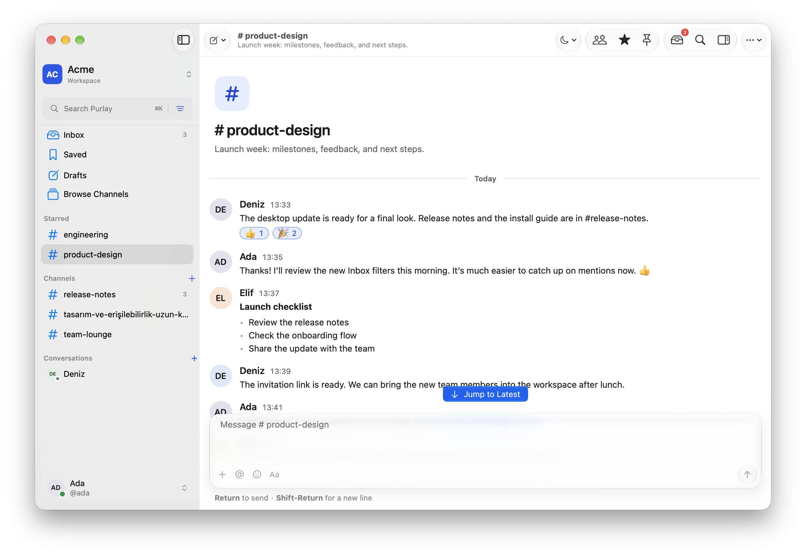

<div align="center">
  
  <h1>Purlay for macOS</h1>
  <p>Your team’s conversations, at home on the Mac.</p>
  <p>A native SwiftUI client for <a href="https://github.com/doancan/purlay">Purlay</a>, with Liquid Glass, keyboard navigation, and room to focus.</p>
  <p>
    <a href="https://github.com/doancan/purlay-macos/releases/latest"></a>
    
    
    <a href="LICENSE"></a>
  </p>
  <p>
    <a href="https://github.com/doancan/purlay-macos/releases/latest"><strong>Download for Mac</strong></a>
    &nbsp; · &nbsp; <a href="CHANGELOG.md">What’s new</a>
    &nbsp; · &nbsp; <a href="https://github.com/doancan/purlay-macos/issues">Report an issue</a>
  </p>
</div>

<picture>
  <source media="(prefers-color-scheme: dark)" srcset="docs/images/workspace-dark.png">
  
</picture>
<p align="center"><sub>Purlay 0.1.1 · Native macOS interface · Example workspace</sub></p>

## Conversations, without losing your place

| Stay connected | Stay focused |
| :--- | :--- |
| **Channels & direct messages** — keep team discussions and smaller conversations together. | **A focused Inbox** — filter mentions, direct messages, and threads; catch up on unread activity. |
| **Threads & reactions** — reply in context and pick from 221 standard emoji, with search and recents. | **Deep Work** — quiet interruptions for a focus session, then return to what needs you. |
| **Files & rich messages** — browse attachments, preview content, and read formatted messages and code. | **Saved messages & drafts** — keep useful context nearby and return to unfinished thoughts. |

## Made for the Mac

- **Native window controls.** A system toolbar and sidebar, Liquid Glass controls, and a thread inspector beside the conversation.
- **Keyboard-first navigation.** Jump between channels, search messages, and act through the File, Message, Channel, and Go menus.
- **Your preferred appearance.** Light and dark themes, comfortable or compact messages, and support for Reduce Transparency, Increase Contrast, and Reduce Motion.
- **Built-in updates.** Sparkle checks for new versions and verifies signed update feeds, release notes, and app downloads.
- **Workspace-aware settings.** Profile and account details, a native member list, and administration links that follow your workspace role.

## Get started

1. [Download the latest release](https://github.com/doancan/purlay-macos/releases/latest).
2. Extract the ZIP and move **Purlay.app** to **Applications**.
3. Open Purlay, enter your server address, and sign in.

**Requirements:** an Apple Silicon Mac, macOS 26 or later, and access to a compatible [Purlay server](https://github.com/doancan/purlay). The desktop app connects to your server; it does not host one.

**Coming from 0.1.0?** Install 0.1.1 manually once. Version 0.1.0 has no built-in updater. From 0.1.1 onward, use **Purlay → Check for Updates…** or enable automatic checks in **Settings → Updates**. Intel builds are no longer provided.

Release builds are signed with Developer ID and notarized by Apple. Each release includes a SHA-256 checksum.

## A few useful shortcuts

| Action | Shortcut |
| :--- | :--- |
| Jump to a channel or person | `⌘ K` |
| Search messages | `⇧ ⌘ F` |
| New conversation | `⌘ N` |
| Open Inbox | `⇧ ⌘ I` |
| Toggle Deep Work | `⇧ ⌘ D` |
| Show all shortcuts | `⌘ /` |

## Workspace administration

Owners and administrators can open workspace settings, members, invitations, integrations, and the audit log. Data and history management is available to owners. Server administrators also see **Server Settings**, which opens server management in the browser. This requires server administrator permission, independently of the workspace role.

The member list is native. **Invitations, role changes, and other management changes open in your browser**, where you may need to sign in separately. To add someone, create an invitation link, share it, and have them accept it after signing in.

## Build & contribute

Use Xcode 27 or later and [XcodeGen](https://github.com/yonaskolb/XcodeGen). The app is written in Swift 6, with SwiftUI and AppKit.

```sh
xcodegen generate
xcodebuild -project Purlay.xcodeproj -scheme Purlay \
  -configuration Debug -destination 'platform=macOS,arch=arm64' build
```

See the [development guide](docs/DEVELOPMENT.md) for the pinned API contract, local setup, signing, and release process, and the [testing guide](docs/TESTING.md) for validation. Contributions follow the [contributor agreement](CLA.md).

---

<div align="center">
  <a href="https://github.com/doancan/purlay">Purlay server & web</a> ·
  <a href="CHANGELOG.md">Changelog</a> ·
  <a href="LICENSE">AGPL-3.0</a> ·
  <a href="NOTICE">Third-party notices</a>
</div>
