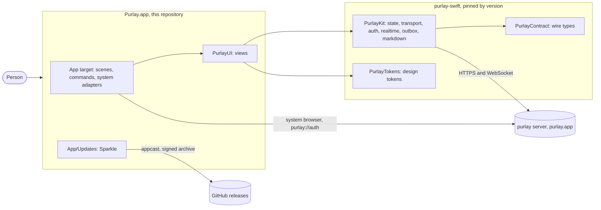

# Architecture overview

Purlay for macOS is a client: it holds no server and no business rule of the server. It draws what the shared client engine
([`purlay-swift`](https://github.com/purlay/purlay-swift)) models, and it ships as a signed, notarized, self-updating app.
This describes what the code is; the reasons are in [`../decisions/`](../decisions/).

## Context and containers

## Modules

| Module | Where | Responsibility | Depends on |
|---|---|---|---|
| App target `Purlay` | `App/` | The shell: `Window`, `WindowGroup` for conversation windows and `Settings` scenes, menu commands, the app delegate (the app lives on when the last window closes, so the socket stays open and a notification can arrive), URL handling. Adapters to the system: `Environment.swift` (Keychain, defaults, files, network), `SystemBrowserAuthenticator` (sign-in in the system browser), `SystemAttention` (Dock badge, notices), `LoginItem` (`SMAppService`). | `PurlayUI`, `PurlayKit`, `PurlayContract`, `PurlayTokens`, Sparkle |
| Updates | `App/Updates/` | `UpdateController`, the menu item and the Updates settings tab. The only place that imports Sparkle. | Sparkle |
| `PurlayUI` | `Packages/PurlayUI` | Every screen and control: sidebar, conversation, composer, thread, inbox, issues, settings, palette. Views read a model and call it; they open no connection. Colour, spacing and type come from tokens (`TokenBinding`, `NativePalette`); every sentence is in `Strings.swift` and the string catalog. | `PurlayKit`, `PurlayContract`, `PurlayTokens` |
| `purlay-swift` | external package | `PurlayContract` (generated wire types), `PurlayKit` (the model, `AppModel`; session store, transport, handshake, realtime with replay, durable outbox, uploads, markdown), `PurlayTokens`, `PurlayTestSupport`. | the server's contract bundle |
| Sparkle | external, exact version in `project.yml` | In-app updates from a signed appcast. | — |

Dependencies point inward: the app target depends on `PurlayUI`; `PurlayUI` depends on `purlay-swift`; nothing in `purlay-swift`
knows about AppKit or this repository. `scripts/enforcement` holds the rules that the compiler cannot (conventions.md).
Any directory under `Packages/` other than `PurlayUI`, and `Tests/` and `Tools/`, is an ignored, empty leftover of the move to `purlay-swift`.

## Main flows

- **Sign-in.** The app opens the server's sign-in page in the system browser (`ASWebAuthenticationSession`), the server redirects to
  `purlay://auth` with a one-time code, the app exchanges it, and the session is kept in the Keychain until sign-out. There is no
  password field in the app. Only `https://purlay.app` is offered; Debug builds may be pointed elsewhere with `PURLAY_DEV_SERVER`
  and plain HTTP to localhost (the preprocessor adds that App Transport Security key in Debug only).
- **Start and handshake.** `GET /api/client` gives the server version, contract version, capabilities and the minimum macOS
  app version; the engine refuses a server it cannot read and says why. Features are switched on by capabilities, never by version.
- **Reads, writes, realtime.** Reads and writes go over HTTP with the generated client; one WebSocket per session carries events and
  replays from its cursors after a reconnect. A send is painted first and reconciled after; a failed send stays visible with a retry (the outbox).
- **Attention.** The model decides what needs the person; `SystemAttention` shows it as a Dock badge or a notice, asks for the
  permission the first time there is something to tell, and never carries message content in a notice.
- **Update and release.** A `v*` tag runs `.github/workflows/release.yml`: every verify lane, a signed arm64 build, notarization,
  a signed Sparkle appcast, and a GitHub release. Installed apps read `releases/latest/download/appcast.xml`
  ([`../runbooks/release.md`](../runbooks/release.md)).

## Sandbox and signing

The app is sandboxed. Its entitlements are an allowlist (`App/Resources/Purlay.entitlements`): the sandbox, outgoing network,
user-selected files (read-write), and two mach-lookup exceptions for Sparkle's installer services. Debug adds only
`disable-library-validation` so the prebuilt Sparkle loads under ad-hoc signing. `scripts/verify app` checks both the declared and
the signed entitlements against that allowlist. Release uses Developer ID and the hardened runtime; library validation stays on.

## Non-functional requirements in the architecture

| Concern | Where it shows |
|---|---|
| Security | no password in the app; Keychain; sandbox allowlist; strict App Transport Security in Release; signed and notarized builds; signed update feed; gitleaks over the history |
| Privacy | notices carry no message content; local state is scoped by server, account and workspace |
| Accessibility | labels on every control, Dynamic Type, Reduce Transparency, Increase Contrast and Reduce Motion followed; Liquid Glass can be turned off |
| Localization | one string catalog, English and Turkish, checked by `scripts/localize --check` |
| Offline | the durable outbox keeps unsent messages across a relaunch; the engine replays from its cursors on reconnect |
